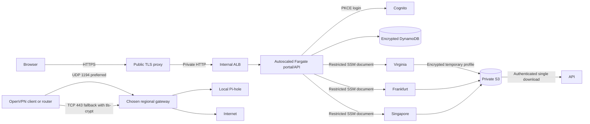

# Deploy and operate NavalnyVPN

## Architecture



The public TLS proxy, internal ALB, Fargate portal service, and Cognito live in Virginia. Fargate starts at two tasks and uses CPU and memory target tracking to scale between the configured minimum and maximum. DynamoDB shares user, session, OAuth, profile, and rate-limit state between tasks; rate-limit buckets use hashed client keys and TTL. The portal image is stored in a private, scan-on-push ECR repository. Each VPN region has an independent VPC, gateway, static IP, CA, CRL, Pi-hole, and persistent encrypted EBS volume. Client private keys are generated at the gateway, delivered over TLS through private encrypted S3, then removed locally. Downloaded objects are immediately deleted. SSM receives operation status, never a private key.

Gateway IAM roles can write/delete only their own regional S3 prefix. The Fargate task role can read/delete profile objects, invoke only the named management documents on the specified gateways, read command status, and access its DynamoDB table. AWS does not support resource-level authorization for `ssm:GetCommandInvocation`, so that single action uses `Resource: *`.

The Fargate service uses `awsvpc`; task security groups accept application traffic only from the internal ALB. Public requests terminate TLS at Caddy on the proxy host. Tasks use an ECS task role for only the required DynamoDB, S3, and Systems Manager actions. The public proxy has no AWS application permissions. VPN gateway firewall rules isolate clients from metadata, private networks, host services, and each other. Standard DNS is redirected to Pi-hole; DNS-over-TLS is blocked. Pi-hole administration binds to loopback.

## Prepare

1. Install Node.js 22.13+, Terraform 1.9+, and AWS CLI v2. Authenticate with a provisioning identity. The application stores no AWS access keys.
2. Check regional quotas and costs. The default footprint includes three VPN `t3.small` gateways, a proxy `t3.small`, two always-on 0.5-vCPU/1-GiB Fargate tasks, an internal ALB, public IPv4 addresses, DynamoDB, and encrypted disks. Fargate, ALB, public IPv4, and outbound VPN bandwidth incur ongoing charges; the service is free for users, not free to operate. CPU credit mode on the EC2 hosts is standard; sustained load can reduce throughput.
3. Review dependency/container releases, OS updates, blocklists, and licenses. Pin container digests for an immutable release. Fonts are served locally, with no external analytics or font requests.
4. Configure encrypted remote Terraform state and locking for team use. Until configured, this project uses local state. Protect state, snapshots, SSM access, Cognito administration, and regional CA disks.
5. Set AWS Budgets, operational alerts, and a backup schedule before a public launch. Those account-level operations are not performed by this baseline.

```sh
# From the project root:
npm ci
npm test
npm run build
cd infra
cp terraform.tfvars.example terraform.tfvars
terraform init
terraform fmt -check -recursive
terraform validate
terraform test
terraform plan -out=navalnyvpn.tfplan
```

PowerShell also supports `Copy-Item terraform.tfvars.example terraform.tfvars`.

Set `enabled_regions` to any supported set containing `us-east-1`. Use only `["us-east-1"]` for a smaller initial deployment. A new region needs an explicit provider alias, another gateway module invocation, and metadata in `local.gateways`; Terraform cannot select provider aliases dynamically.

## Apply and inspect bootstrap

After reviewing the saved plan and costs:

```sh
terraform apply navalnyvpn.tfplan
terraform output
```

The first apply creates the ECR repository and the rest of the foundation with the Fargate service disabled (`portal_service_enabled = false`). Build and push the exact immutable tag selected in `app_image_tag` (default `v1`), then enable the service:

```sh
cd ..
repository=$(cd infra && terraform output -raw portal_image_repository)
registry=${repository%%/*}
aws ecr get-login-password --region us-east-1 | docker login --username AWS --password-stdin "$registry"
docker build --platform linux/amd64 -t navalnyvpn:v1 .
docker tag navalnyvpn:v1 "$repository:v1"
docker push "$repository:v1"
cd infra
terraform apply -var='portal_service_enabled=true' -var='app_image_tag=v1'
```

Repeat the image build/push with a new immutable tag for each release, then apply with that tag. Existing SQLite data on a previously deployed control host is not automatically imported into DynamoDB; export and migrate existing profiles before enabling the new task service. Fresh deployments start with an empty DynamoDB table.

Resource creation does not establish cloud-init readiness. Use SSM Session Manager, without opening SSH:

```sh
aws ssm start-session --target CONTROL_INSTANCE_ID --region us-east-1
# The SSM session is the TLS proxy host:
sudo cloud-init status --wait
sudo docker ps
curl --fail http://127.0.0.1/api/health
sudo journalctl -u cloud-final --no-pager -n 100
```

Inspect Fargate task health and scaling in the ECS console or with `aws ecs describe-services`. The ECR repository URL, DynamoDB table name, and Fargate service name are Terraform outputs.

In each gateway's own region, inspect it through SSM:

```sh
sudo cloud-init status --wait
sudo /usr/local/sbin/navalny-profile health health
sudo systemctl status openvpn-server@server
sudo docker exec pihole pihole status
sudo docker exec pihole pihole -q doubleclick.net
sudo dig @10.8.0.1 example.com
sudo iptables -S NV-FORWARD
```

Validate actual blocked-domain DNS responses, too. An adult test domain can be selected from the configured list and queried without visiting it. Never expose public DNS or Pi-hole administration for debugging.

The Pi-hole UI is `127.0.0.1:8080` on each gateway. The random admin password is generated locally at `/var/lib/navalnyvpn/pihole-admin-password`; retrieve it only in your private SSM session. Use SSM port forwarding to access the UI privately.

## Activate DNS later

**No registration, hosted zone, or DNS record is created.** The intended hostname is `navalnyvpn.net`.

Once the domain is owned and activation is intended, manually create the A record shown by `terraform output future_dns_record`. It points the portal hostname to the portal static IP. Profiles use gateway static IPs, so gateway DNS records are optional. Do not add an AAAA record for this IPv4 baseline.

Caddy obtains HTTPS certificates after DNS resolves. Cognito's callback is `https://navalnyvpn.net/auth/callback`; logout returns to `https://navalnyvpn.net`. To use another hostname, change `domain` in Terraform and reapply so the proxy, allowed origin, and Cognito URLs agree.

Cognito managed login provides registration, email verification, password recovery, and sign-in. Its default email delivery has quotas; configure a verified SES sender before public service. Managed-login v2 branding is explicitly created per app client. The pool supports optional TOTP, but this baseline has no in-app MFA enrollment screen.

## Validate the live service

1. Register and verify an account through the deployed portal.
2. Create a profile for a device in one region. It becomes ready only after SSM reports successful issuance.
3. Download the `.ovpn` once. It contains a private key. Keep it out of Git, logs, tickets, shared links, and third-party testing sites. The profile tries UDP/1194 first and TCP/443 if that connection fails. Revoke and replace if lost.
4. Import into OpenVPN Connect. Check external IPv4 against the selected gateway's output. Check DNS and ensure no native IPv6 escapes the tunnel.
5. Query normal and blocked domains, and confirm standard DNS directed to alternate resolvers is redirected. DNS-over-HTTPS may bypass filtering and needs browser/client policy for stricter control.
6. Confirm clients cannot access `169.254.169.254`, VPC private IPs, host administration, or each other.
7. Revoke the connected profile. Its existing session should terminate and reconnect must fail. Retry any displayed revocation error until confirmed.
8. Repeat in each region and on every supported client platform before opening public registration.

OpenVPN Community on Linux does not automatically apply `dhcp-option DNS`. Use NetworkManager's OpenVPN plugin or the distribution's `openvpn-systemd-resolved` integration. Configure kill switches and IPv6 protection explicitly. The website cannot control OS routing.

For household-wide protection, import a dedicated profile into an OpenVPN-compatible router. Route the intended household traffic through it, remove unintended split routes and alternate/secure DNS, and test IPv6 behavior. Devices outside that tunnel are unaffected. The VPN does not expose a home network to other VPN clients.

## Retention and privacy

- Every certificate is tied to an account, device name, and region. Certificates last 365 days; replace before expiry. CA/CRL validity is ten years and requires planned maintenance.
- Profile artifacts are stored in an unversioned encrypted private S3 bucket. Download deletes immediately; revocation requests deletion too. A one-day lifecycle rule cleans up unused objects asynchronously, not at a guaranteed exact time.
- Web sessions last one hour. Cognito ID/access tokens last 15 minutes and are discarded after verification; refresh tokens are not stored. Logging out does not revoke VPN profiles.
- In AWS, DynamoDB stores account/session metadata, device names, region, certificate IDs, dates, status, and download state. Locally, SQLite stores development data. Neither database stores client private keys.
- Pi-hole DNS query history is disabled. OpenVPN verbosity is low. OS, AWS, SSM, upstream DNS, and operational logs can still contain metadata. This is not an audited no-logs/anonymity claim.
- Region cards show configuration, not continuous availability monitoring. The portal does not invent live latency, bandwidth, connection activity, or block counts.

## Backup, updates, and recovery

Data volumes use `prevent_destroy = true`. Take encrypted EBS snapshots in every region before upgrades or replacements. Configure AWS Backup or DLM for volumes tagged `NavalnyBackup=true`; scheduling is an operator task here.

Use DynamoDB point-in-time recovery and export a protected backup before destructive changes. The retained control EBS volume can contain an earlier SQLite database; do not delete it until its data has been reviewed and any needed profile records migrated. Back up the regional PKI as well. Restoring the database without matching PKI may make revocation impossible; restoring outdated CRLs can resurrect revoked profiles. Reconcile revocations before reopening restored gateways.

For app updates, build and push a new ECR image tag, then apply with the new `app_image_tag`. ECS rolls Fargate tasks behind the ALB with a deployment circuit breaker and rollback. Gateway script changes replace that gateway and reattach its PKI disk, briefly disconnecting users. Plan maintenance windows. Retained disks must stay in the same availability zone; an AZ migration needs a reviewed snapshot/restore procedure.

Maintain Ubuntu/OpenVPN packages and Pi-hole image releases. Gravity lists refresh every eight hours. Host patching, monitoring, abuse prevention, and backup automation remain operational responsibilities. Portal tasks scale automatically; gateways remain single-instance per region and need a separate capacity/failover design for higher VPN load.

Existing tunnels can survive a portal or TLS-proxy outage until the tunnel reconnects. A gateway outage disconnects its region. There is no automatic cross-region certificate failover.

## Teardown

`terraform destroy` is intentionally blocked by protected EBS volumes and Cognito deletion protection. The S3 bucket refuses deletion while nonempty. Before removing protections, export needed account data, back up or deliberately retire each CA, revoke access, and explicitly decide to delete the service. Then remove protections in reviewed source, empty the intended artifact bucket, and destroy reviewed resources. Remove any manually created DNS record separately.

## Verification boundaries

Local API tests, container builds, and mocked Terraform plans do not establish AWS permissions, quotas, email delivery, or DNS correctness. The gateway fixture uses real certificate tools and a real tunnel, while cloud transport and service/DNS readiness are mocked. Real Cognito callbacks, cross-region SSM/S3 delivery, external connectivity, platform-specific DNS/IPv6 behavior, throughput, and restoration must be verified on the live deployment.
